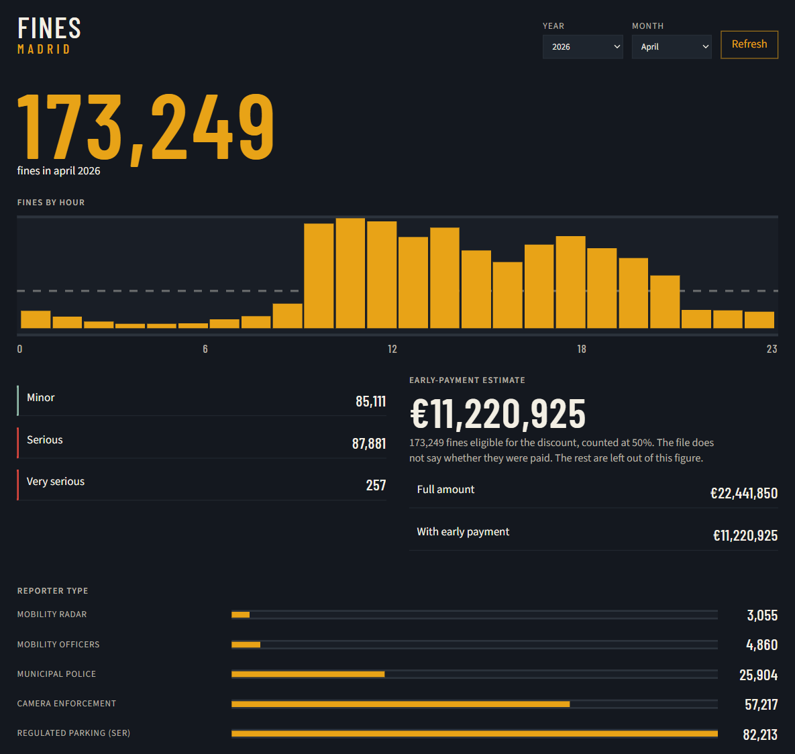
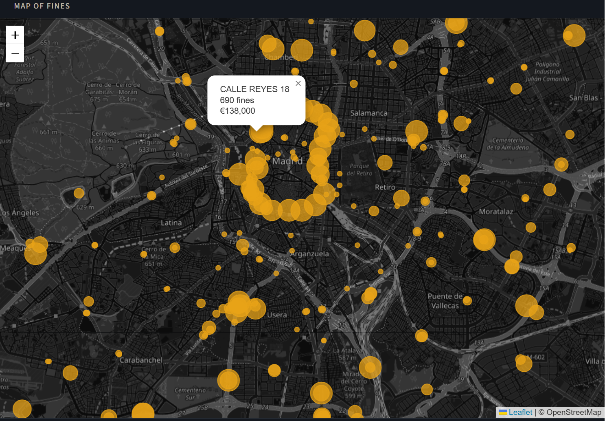

# Madrid Fines

When Madrid issues fines, who reports them, and what the early-payment discount would come to. The program downloads the City Council's monthly detail, stores it as Parquet, and opens it in a local page.



## April 2026

- 173,249 fines. The busiest hour is 10:00, with 16,098. Between 10:00 and 13:00 falls 34.5% of the month. There is another peak at 17:00, with 13,502. Between 02:00 and 05:00 the count drops below one thousand.
- SER, the regulated parking service, files 82,213. Camera enforcement files 57,217. The Municipal Police files 25,904.
- The amount printed on the tickets adds up to €22,441,850. In this month all 173,249 rows have `DESCUENTO` set to `SI`, so the 50% estimate is €11,220,925. The open data does not say whether they were paid.

The same page splits fines into minor, serious, and very serious, and places the streets on a map.



The dataset is [Traffic fines: detail](https://datos.madrid.es/dataset/210104-0-multas-circulacion-detalle). The City Council updates it every month, about three months after the offence. The files remain theirs, under the CC BY 4.0 licence. This repository contains only the code. The screenshots above are April 2026, already downloaded locally.

## Installation

```bash
pip install -e ".[dev]"
```

Python 3.10 or later.

## Usage

The latest published month:

```bash
madridfines sync
```

A specific month, a year, or the history from June 2017:

```bash
madridfines sync --year 2026 --month 4
madridfines sync --year 2025
madridfines sync --from 2017-06
```

`--refresh` requests the file again even when the local copy is less than seven days old. `--obsolescence` changes that window. The CSVs are not versioned: they stay in `data/`.

The browse page:

```bash
madridfines serve
```

Opens `http://127.0.0.1:8000`. From there you pick a month and, if it is not on this computer, download it.

## Layout

```
├── src/madridfines/
│   ├── catalog.py     reads the portal and keeps the Detail CSVs
│   ├── sync.py        downloads the requested months
│   ├── cleaning.py    normalizes text, amounts, and the time
│   ├── cache.py       keeps the HTML and the CSVs for a few days
│   ├── store.py       writes the Parquet and queries it with DuckDB
│   ├── fines.py       the library: loads months and summarizes them
│   ├── cli.py         the sync and serve commands
│   └── web/           the local page
├── tests/             covers the package without opening charts or going online
├── docs/
│   ├── pagina.png     the April 2026 dashboard
│   └── screen.png     the April 2026 map
└── pyproject.toml     the package and the madridfines command
```

`data/` is not versioned.

## Library

```python
from madridfines import Cache, CacheURL, MadridFines, get_url

cache = Cache("lookup", cache_dir="data/cache")
cache.set("note.txt", "hello")
cache.load("note.txt")

url = get_url(2026, 4, cache=CacheURL("lookup", cache_dir="data/cache"))

fines = MadridFines("lookup", cache_dir="data/cache")
fines.add(2026, 4)
fines.fines_hour("fines_by_hour.png")
fines.fines_calification()
fines.total_payment()
```

`get_url` reads the portal's download page and keeps resources whose title starts with `Detalle.`. It ignores `Agrupadas-excluidas`. The HTTP cache expires after seven days.

`HORA` arrives as a decimal: `8.21` is 08:21. The money figures are an estimate: the open data does not say whether the fine was paid. The 50% early-payment rate applies only when `DESCUENTO` is `SI`. `total_payment` uses that for the minimum amount, and the page does the same for the highlighted figure. The other fines are not halved.

## Fields

Each row is one fine. After cleaning, names have no surrounding spaces, and the coordinates are called `COORDENADA-X` and `COORDENADA-Y` even when the original month used an underscore.

- `CALIFICACION`: LEVE, GRAVE, or MUY GRAVE (minor, serious, or very serious)
- `LUGAR`: street and number
- `MES`, `ANIO`, `HORA`: when it was recorded
- `IMP_BOL`: amount in euros printed on the fine. Not a confirmed payment
- `DESCUENTO`: whether early payment is allowed. Only the value `SI` authorizes the 50% rate
- `PUNTOS`: points withdrawn
- `DENUNCIANTE`: who filed the report
- `HECHO-BOL`: description of the offence
- `VEL_LIMITE`, `VEL_CIRCULA`: speeds, when present
- `COORDENADA-X`, `COORDENADA-Y`: ETRS89 / UTM zone 30. In recent files the figure is in hectometres

The page projects those coordinates to latitude and longitude only for the map, and drops points that fall outside the city.


